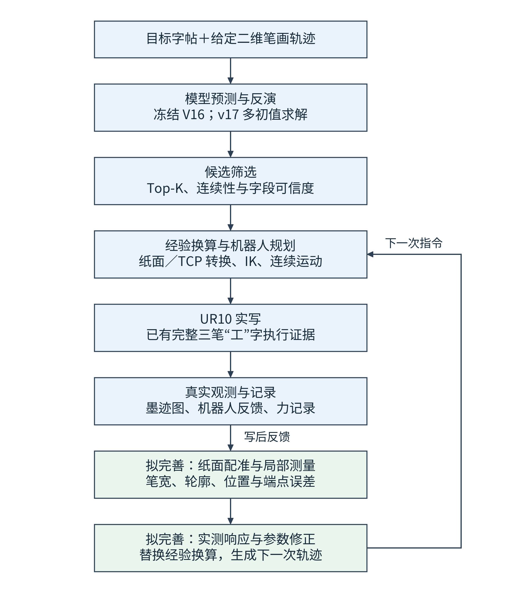
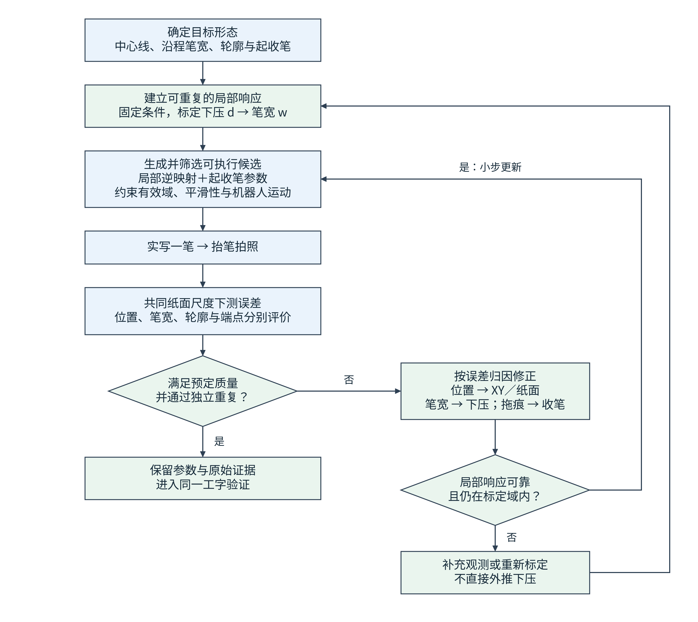
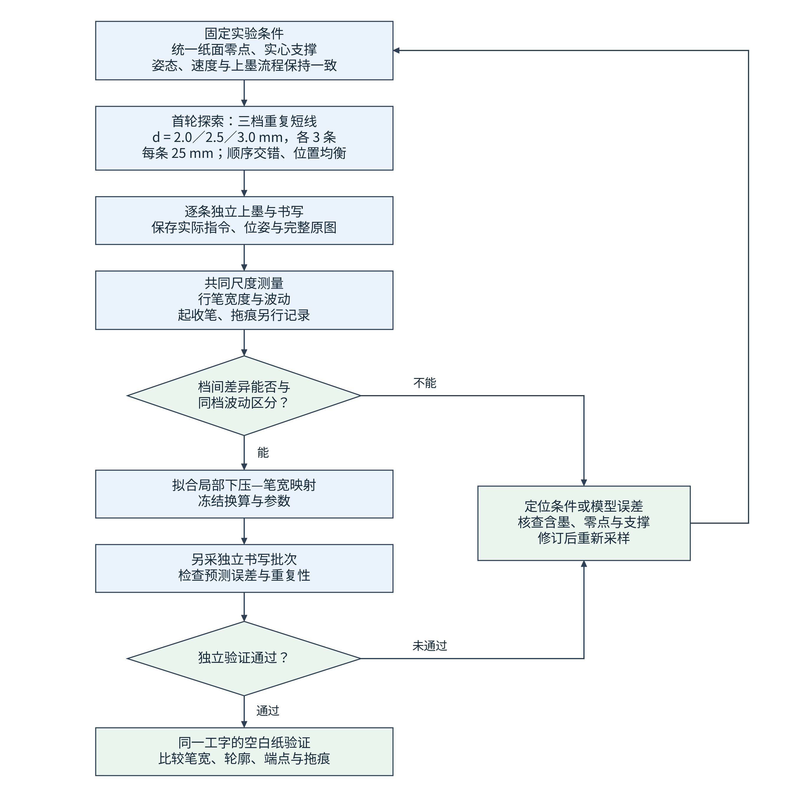

# 写字机器人的整体方案与高质量笔画生成

## 1. 对最初问题的直接回答

写字机器人的任务，是把目标字帖中的笔画形态转成机器人能够实际执行、并且能在纸上重复形成相近墨迹的动作。

本项目已经具备目标图与二维轨迹输入、笔触正向模型、多解反演、机器人轨迹转换和完整“工”字实写的基础。当前最需要补齐的是：**建立这支真实毛笔在确定纸面、姿态、速度和含墨条件下，对下压指令的可重复响应，并把这种响应用于轨迹生成和实写修正。**

提高笔画质量可以按三个层次推进：

1. **确定要写成什么样。** 从目标笔画取得中心线、沿程宽度、轮廓和起收笔形态。
2. **确定真实毛笔怎样才能写出来。** 用实测关系把这些形态要求转成下压、姿态、速度和抬落笔过程。
3. **用实写误差修正下一次动作。** 拍照、配准、测量局部误差，再在已验证的范围内更新参数。

完整执行已经取得证据；“每个位置该下压多少、怎样收笔、能否稳定重复”是接下来要解决的具体问题。

## 2. 整体系统如何工作



图1：浅蓝色表示项目已有主链，浅绿色表示拟完善的自动测量与反馈环节。已有实写和数据采集，不等于自动优化闭环已经完成。

[查看矢量图](assets/writing_robot_flowcharts/01_system_academic.svg) · [Mermaid 源码](assets/writing_robot_flowcharts/01_system_academic.mmd)

下面八步与图1的八个文本框一一对应。已有模型、执行和采集能力可以作为基础；第2.7、2.8步的自动衔接与优化仍需完善。以下说明实施方法，没有在本次文档修改中执行这些实验。

### 2.1 目标字帖＋给定二维笔画轨迹

- **要做什么：**明确本次要写哪个字、使用哪份目标，以及每一笔的顺序和初始走向。
- **输入：**目标图像、带笔画编号的二维轨迹、拟采用的物理字号。
- **怎么做：**按样本编号匹配图像和轨迹；核对笔画数量、顺序、坐标方向和角度单位。保留原始文件，在副本中做目标裁剪、墨迹分割和有限配准。预先指定纸面上的字号与位置，不用最终实写结果反向调整目标大小。
- **输出与下一步：**得到同一编号的目标图、目标掩膜、逐笔轨迹及单位说明。图像与轨迹对应关系确认后进入反演；对应不清时先修正输入材料。

### 2.2 模型预测与反演

- **要做什么：**寻找能在模型中产生接近目标墨迹的多组参数。
- **输入：**上一步的目标与轨迹、冻结的V16权重、渲染尺度和角度约定。
- **怎么做：**将每笔参数表示为少量节点，利用动态笔刷描述宽度、拖曳和偏移，再通过B-BSMG生成局部足迹并合成为整字。v17从多个初值运行PSOC/LM，保存各候选的参数、预测图和误差。真实目标入口参考[批量反演工具](../tools/invert_kaishu_v17_batch.py)；[多解回归工具](../tools/run_paper_v17_multisolution.py)用于合成真值恢复等试验，两类结果分开解释。
- **输出与下一步：**得到多组六字段候选、渲染图和诊断报告，交给候选筛选。V16的解析足迹监督不提供真实毛笔姿态标签。

### 2.3 候选筛选

- **要做什么：**从模型候选中选出形态较好、参数稳定且适合继续物理转换的方案。
- **输入：**候选轨迹、目标/渲染对照、连续性与可信度报告。
- **怎么做：**先检查触边、参数跳变和报告中的导出条件，再比较局部足迹、图像误差及多初值稳定性。用[正向重放工具](../tools/render_paper_trajectory.py)复用候选原有的动态参数、尺度和γ约定。角度无法辨识时保留低置信标记，后续固定该变量或保留多解，不把排名第一解释成唯一真实动作。
- **输出与下一步：**得到带选择理由和字段可信度的Top-K候选。通过模型筛选只允许进入物理换算，还不代表可以直接执行机器人运动。

### 2.4 经验换算与机器人规划

- **要做什么：**把模型候选转成纸面中的笔尖位置、下压和姿态，再转成机器人可执行轨迹。
- **输入：**候选六字段、纸面坐标、自然笔尖偏移、工具姿态约定、当前有效的换算记录。
- **怎么做：**先统一源XY、纸面坐标和机器人坐标，再将模型H按当前记录换成指令下压d。根据纸面法向计算笔尖目标；变姿态时联合补偿笔尖和工具位置。随后做逆运动学与连续路径检查，加入落笔、抬笔和笔间转移，按最终速度、加速度和过渡参数评估。工具定位见[候选准备](../tools/prepare_gong_model_trial.py)与[换算调整](../tools/regain_gong_candidate.py)。
- **输出与下一步：**得到绑定坐标、换算版本及路径检查结果的机器人候选。未通过的候选返回本步调整，不能用模型图像分数替代执行条件。

其中三个量必须分列，避免把同一个“H”用于不同含义：

| 量 | 含义 | 当前用途 |
| --- | --- | --- |
| 模型 H | 正向渲染与反演中的模型参数 | 生成和比较模型候选 |
| 指令下压 d | 相对指定纸面零点的几何指令 | 生成机器人目标位姿 |
| 实际毛束压缩量 | 接触后真实毛束的变形量 | 需要独立观测或经过验证的估计 |

在纸面局部坐标中，设纸面基点为 p₀、两个切向单位向量为 e₁/e₂、向上法向为 n，则名义自然笔尖位置可以写为：

```text
p_tip = p₀ + x_p e₁ + y_p e₂ − d n
```

公式中的位置与d先统一长度单位，再转换为机器人接口所需的米制量。若笔尖偏移为工具坐标中的t_tip，则工具原点位置为 `p_tool = p_tip − R_tool t_tip`。角度需绑定旋转约定，尤其区分画布绝对γ、相对切向γ和纸面绝对γ。

### 2.5 UR10实写

- **要做什么：**验证选定候选在真实笔、纸和墨条件下产生怎样的笔画。
- **输入：**上一步的最终运动候选、有效现场条件和实验编号。
- **怎么做：**按现有实写流程执行已选定方案，采集实际位姿与执行状态；本轮只改变计划中的变量，保留源轨迹和其他条件。入口定位为[工字试写工具](../tools/run_gong_model_trial.py)。完整程序是否结束、哪些笔画实际经过、是否最终抬笔，分别按日志确认。
- **输出与下一步：**得到执行记录和真实墨迹。完整执行后进入写后观测；部分执行保留为部分结果，不纳入完整字符的质量比较。

### 2.6 真实观测与记录

- **要做什么：**让每份墨迹图都能追溯到对应的实际动作与条件。
- **输入：**书写结果、机器人反馈、力记录和拍照配置。
- **怎么做：**完成抬笔后进入独立拍照流程，确认完整目标区域在视野内，保存原始图像、相机参数和拍照位姿；相应接口见[墨迹拍照工具](../tools/photo_gong_ink.py)。将指令、实际反馈、墨迹图和纸面/工具版本绑定到同一实验编号。图像与点云分别保留采集信息，不默认不同触发的数据为同步曝光。
- **输出与下一步：**得到可追溯的样本包。出现字符出画、旧墨混入或缺少尺度信息时，标记为观察样本，先补采再进入正式质量测量。

### 2.7 纸面配准与局部测量

- **要做什么：**把照片中的差异转换为毫米尺度下的位置、宽度、轮廓和端点误差。
- **输入：**目标图、实写原图、相机与纸面标定、笔画轨迹。
- **怎么做：**利用相机几何和纸面记录生成正射视图，将目标与实写放在共同纸面坐标中，再分割墨迹。沿已知笔画路径计算宽度与中心偏移，起收笔单独取区评价。已有[毫米测量接口](../tools/brush_capture_measure.py)可作基础，但正式闭环仍需验证。配准使用独立几何基准，不把实写图任意拉伸到目标上来减小误差。
- **输出与下一步：**得到误差曲线、毫米轮廓和质量标记。测量有效才进入参数更新；视野、分割或配准失败时回到观测环节。

### 2.8 实测响应与参数修正

- **要做什么：**把真实测量用于下一次动作，逐步替代单一经验增益。
- **输入：**局部误差、重复样本、当前换算与其有效范围。
- **怎么做：**先检查误差来自几何位置、笔宽响应还是收笔过程，再分别更新有限XY、下压曲线或起收笔参数。每次更新保存父版本、修改量和预期影响，重新经过第2.4步的物理转换与规划。具体更新规则见第4节。
- **输出与下一步：**得到新版本的响应关系和待试写候选。闭环是否有效，以新一轮实写误差和独立重复结果判断。

## 3. 已有结果说明了什么

### 3.1 完整书写链路已经打通

归档的纸面补偿版“工”字运行记录为 `completed_buffered_program`，三笔全部经过，最后抬笔；冻结源控制点 6＋4＋6 逐行保留。

本轮换算从初始的 `d = 0.045 H`，调整为 `d = 0.22 H`，再加入纸面补偿：

```text
d = 0.22 H + 1.6 mm
```

在该候选的 H 范围内，指令下压为 4.02–6.00 mm。这份换算仍标记为临时经验换算，实际毛束压缩量没有因此被独立测得。

实施记录中的平均线宽为 5.21 mm。但相应照片含有既有墨迹，部分字符超出视野；该数值在进展发布时没有独立复算。因此，它支持“已经取得加粗结果”，单遍质量与重复性还需空白纸对照。

### 3.2 纸面零点确实影响下压解释

当前平面记录显示，纸面相对历史平面低约 1.61 mm。沿用旧零点时，同样的指令会使实际接触偏浅，所以加入约 1.6 mm 补偿有明确的几何依据。

记录中的平面残差 p95 为 1.01 mm。这是点云相对拟合平面的残差，不能直接解释为笔尖定位误差或真实压入量精度。下一步仍要固定纸面、支撑和接触基准。

### 3.3 短线证明可以写粗，稳定控制仍待验证

重新上墨后的六档短线记录如下。下压量使用当时的历史纸面零点，各档只有单次记录。

| 指令下压 d / mm | 记录线宽 w / mm |
| ---: | ---: |
| 2.0 | 4.52 |
| 2.5 | 5.14 |
| 3.0 | 9.45 |
| 3.5 | 6.37 |
| 4.0 | 7.40 |
| 5.0 | 9.25 |

这组数据说明较宽笔画已经可达，但响应非单调：3.0 mm 档比 3.5 mm 档记录得更宽。连续写线中的含墨变化、纸面位置和支撑没有被隔离，尚不能唯一判定原因，也不能直接据此拟合稳定的下压—笔宽曲线。

同源照片还可见边缘参差与提笔拖墨。因此，接下来要同时解决“笔宽是否稳定”和“端点是否干净”，而不能只继续提高下压增益。

## 4. 具体怎样生成更高质量的笔画



图2：这是拟实施的质量提升闭环。先建立可重复的真实响应，再生成可执行候选；实写不达标时按误差类型修正。响应不可靠或超出标定域时，回到观测与标定。

[查看矢量图](assets/writing_robot_flowcharts/02_stroke_loop_academic.svg) · [Mermaid 源码](assets/writing_robot_flowcharts/02_stroke_loop_academic.mmd)

下面十步逐一解释图2的处理框、判断框和反馈分支。本节是拟实施方法；现有实写、采集和反演工具是实现基础。

### 4.1 确定目标形态

- **要做什么：**把“写得像”转换为逐笔、逐位置的可测要求。
- **输入：**指定物理字号的目标掩膜与给定二维笔画轨迹。
- **怎么做：**按弧长s对轨迹等间距采样，得到参考中心线c*(s)。计算局部切向及其法向，在法线上寻找目标墨迹左右边界，两侧距离给出目标宽度w*(s)。起笔、收笔和交叉区域单独标记；交叠处优先采用单笔目标或逐笔观测，不将合并墨迹宽度当作单笔宽度。配准只允许预先确定的尺度、方向和有限几何修正。
- **输出与下一步：**得到中心线、目标宽度曲线、端点区域和有效测量区；同时预先确定宽度、位置与端点的允许误差。目标形态确定后进入真实响应标定。

### 4.2 建立可重复的局部响应

- **要做什么：**得到这支笔在固定条件下的 `w = f(d)`，明确哪些宽度可达、哪些指令可区分。
- **输入：**重复短线的指令下压、实测宽度和实验条件记录。
- **怎么做：**固定姿态、速度、纸面和上墨流程，按第5节重复采样。每条先提取稳定行笔段的宽度中位数，再比较同档分布与档间差异。数据支持稳定局部单调关系后，建立查表或分段线性插值，并记录有效指令区间、可达宽度区间和重复误差。稳态关系先用于行笔段，起收笔另外标定。
- **输出与下一步：**得到带适用条件和误差范围的局部响应。重复性不足时先走第4.10步补测；响应可信才进入候选生成。

### 4.3 生成并筛选可执行候选

- **要做什么：**把目标宽度曲线转为平滑的下压曲线，并加入可检验的起收笔动作。
- **输入：**c*(s)、w*(s)、局部响应f、起收笔参数和机器人约束。
- **怎么做：**在f的有效范围内查找 `d(s) = f⁻¹(w*(s))`，用少量节点表示并平滑下压曲线；初期固定姿态和速度。将起笔、行笔、收笔分开，保留多组参数组合，评价形态误差后，再做最终轨迹的可执行性检查。目标宽度超出可达区间时，返回补测或调整目标条件，不直接外推。
- **输出与下一步：**得到带版本的候选纸面轨迹、下压曲线和起收笔参数，经过物理转换与规划后交给实写。

三个阶段分别控制：

| 阶段 | 怎么调整 | 怎么观察 |
| --- | --- | --- |
| 起笔 | 设置接触位置、下压过程及开始平移的衔接 | 起笔端轮廓、局部堆墨和偏移 |
| 行笔 | 根据目标宽度确定下压，保持沿程连续 | 行笔宽度、中心偏移和边缘 |
| 收笔 | 设置减压位置、减压过程及平移与抬笔的衔接 | 尾端位置、拖痕与残留连墨 |

联合优化可以采用以下结构，各误差项先按单位、允许偏差或对应参数范围归一化，再设置权重：

```text
J = λw × 宽度误差 + λc × 轮廓误差 + λe × 端点误差
  + λp × 相对源中心线的偏移代价
  + λs × 下压与姿态不连续代价
  + λr × 机器人运动代价
```

当前优先开放下压与少量起收笔变量；有独立姿态响应数据后，再开放对应角度，避免用自由角度补偿未建模的真实误差。

### 4.4 实写一笔与抬笔拍照

- **要做什么：**取得当前候选的真实输出，而不只评价预测图。
- **输入：**选定候选、固定实验条件、空白区域和样本编号。
- **怎么做：**按已有执行流程完成该笔，保留实际反馈；抬笔后按独立拍照流程获取完整墨迹图。每次只改变计划中的参数，分别记录书写完成和图像采集完成。出现执行中断或字符出画时，保留失败范围，不把不完整图纳入完整笔画评分。
- **输出与下一步：**得到同一编号的候选、实际动作与原图，交给共同尺度测量。

### 4.5 共同纸面尺度下测误差

- **要做什么：**区分偏差发生在位置、宽度、轮廓还是端点。
- **输入：**有效实写图像、纸面几何、目标形态和实际轨迹记录。
- **怎么做：**完成正射与固定分割后，在参考路径的法线上测左右边界。左右边界中点相对参考中心线的偏移用于位置评价，两边界间距用于宽度评价；再计算轮廓距离。端点单独统计位置偏移、目标外多余墨迹及拖痕。分割或配准不确定处先标记无效，不让缺失值参与优化。
- **输出与下一步：**得到沿程位置/宽度误差曲线、轮廓与端点指标，以及有效区标记，进入质量判断。

### 4.6 判断：满足预定质量并通过独立重复？

- **要做什么：**判断当前参数是否值得保留，而不是只看一次图像或总分。
- **输入：**预先制定的质量要求、测量误差、独立重复的各项指标。
- **怎么做：**分别核对宽度、位置和端点指标，并检查同条件多次结果是否稳定；不能只用某次最佳结果或加权总分掩盖单项失败。允许误差应在试验前确定，并能被当前测量分辨率区分。一次结果好但尚未重复，只能记为待验证。
- **输出与分支：** **通过**进入第4.7步；有明确形态误差则进入第4.8步。若原因是测量无效，先返回第4.4、4.5步补采或修正测量，不据此调整机器人参数。

### 4.7 保留参数与原始证据

- **要做什么：**将通过验证的方案冻结为可复现基线。
- **输入：**通过质量与重复性判断的参数和样本。
- **怎么做：**一并保存目标版本、响应映射、轨迹、纸面/工具记录、上墨条件、原始图和测量结果，写清有效姿态、速度及宽度范围。进入整字试验时固定这些内容，避免一边验收一边更换条件。
- **输出与下一步：**形成可追溯的单笔基线，进入同一“工”字的空白纸验证。

### 4.8 按误差归因修正

- **要做什么：**使改动对应具体误差，避免一次修改所有变量。
- **输入：**第4.5步的分项误差和当前参数版本。
- **怎么做：**整体位置偏差先核对纸面配准、坐标转换和实际轨迹，再考虑有限XY修正；局部宽度偏差选择调整下压；末端拖墨则固定行笔方案，单独改变减压与抬笔衔接。先提出修改量，不直接执行，交给下一步检查响应依据与有效域。
- **输出与下一步：**得到带修改理由的参数更新建议，进入第4.9步。

在可靠的局部单调区间，可按下面的方法提出宽度修正：

```text
e_w(s) = w*(s) − w_real(s)
g(s) = 当前条件下实测的局部笔宽响应斜率
Δd(s) = η × e_w(s) / g(s)
d_new(s) = 将平滑后的 d(s) + Δd(s) 限制在已验证区间内
```

η是保守更新步长。g过小或符号不稳定时不使用该除法；每次变化还需满足已验证的沿程变化范围。这个公式用于提出待验证候选，改善结果由下一次实写决定。

### 4.9 判断：局部响应可靠且仍在标定域内？

- **要做什么：**确认此次修正有数据依据，并且没有离开映射的适用条件。
- **输入：**更新建议、响应误差与斜率、指令/姿态/速度范围、当前纸面和含墨条件。
- **怎么做：**逐项比较当前条件与标定记录，检查新指令是否在区间内、响应斜率是否稳定、预期改变量是否可分辨。换纸、换笔、明显改变姿态或上墨流程时，不能默认旧响应继续成立。
- **输出与分支：** **可靠且在域内**，按小步更新回到第4.3步重新生成与检查候选；**不可靠或出域**，进入第4.10步。

### 4.10 补充观测或重新标定

- **要做什么：**补齐导致当前修正缺少依据的那部分数据。
- **输入：**有效域检查失败的具体原因、已有样本和条件记录。
- **怎么做：**先排除拍照与分割误差，再针对缺口补同档重复、局部下压档位或独立姿态/速度扫描；每次主要改变一个因素。若为含墨或支撑不稳定，先规范条件，再采数据，不直接用这些混杂样本更新映射。
- **输出与下一步：**得到补充数据和更新后的适用范围，返回第4.2步重新评价响应；随后再生成新候选。

## 5. 下一组实验怎么做

当前最值得先做的是一组受控重复短线，用于判断是否已经具备建立局部笔宽映射的条件。



图3：该实验尚未实施。首轮九条用于探索重复性与档间差异；冻结换算后，另采独立批次验证，通过后再进入同一“工”字的空白纸验证。

[查看矢量图](assets/writing_robot_flowcharts/03_experiment_academic.svg) · [Mermaid 源码](assets/writing_robot_flowcharts/03_experiment_academic.mmd)

下面十步与图3一一对应。前三档与样本数量是首轮探索设计，尚未实施；阈值与判断方法属于本文建议，需要在采样前确定并记录。

### 5.1 固定实验条件

- **要做什么：**使不同短线主要区别来自指令下压，而不是纸面、支撑或上墨方式变化。
- **输入：**当前笔、墨、纸、实心支撑、纸面坐标和工具记录。
- **怎么做：**将全部区域放在相同实心支撑上，固定纸张；建立本次统一纸面零点，记录姿态和速度。规定并记录上墨的浸入范围、退出与刮/沥墨方式、笔毫整理流程，每条均按同一流程处理。先检查全幅拍照及毫米测量是否可用。重新定义零点后重新计算偏置，不重复叠加历史的1.6 mm补偿。
- **输出与下一步：**形成有版本号的条件记录、空白区域与测量基准，进入采样设计。

### 5.2 首轮探索：三档重复短线

- **要做什么：**用少量但可归因的样本观察笔宽响应和重复波动。
- **输入：**固定条件、统一零点、预定宽度测量方法。
- **怎么做：**候选采用d = 2.0、2.5、3.0 mm三档，各3条，每条25 mm；档位均为本次零点下的指令量。将档位均衡安排到不同行列，提前确定交错书写顺序，避免按由浅到深的固定顺序写完。新数据与历史零点下的六档数据分开编号，不直接合并拟合。
- **输出与下一步：**得到9条样本的编号、档位、位置与顺序表。按该表逐条采集，不看见某条不好就自行更换条件。

一个均衡位置布局如下：

| 纸面区域 | 位置 A | 位置 B | 位置 C |
| --- | ---: | ---: | ---: |
| 上区 | 2.0 | 2.5 | 3.0 |
| 中区 | 3.0 | 2.0 | 2.5 |
| 下区 | 2.5 | 3.0 | 2.0 |

表内单位为mm。每档都覆盖不同行列，实际采集顺序另行交错，不把表格的阅读顺序直接当作书写顺序。

### 5.3 逐条独立上墨与书写

- **要做什么：**让每条短线成为有完整条件记录的一次独立书写样本。
- **输入：**采样表、固定条件和对应的最终运动候选。
- **怎么做：**每条开始前按固定流程重新上墨并整理笔毫；按既定顺序在指定空白位置写线，抬笔后拍摄完整区域。保存零点、指令、姿态、速度、上墨流程、位置及实际反馈，力记录单独保存。失败或中断的样本保留原因，补采使用新编号，不覆盖原记录。
- **输出与下一步：**得到逐条可追溯的原始样本包，交给统一测量。未完成或视野不完整的样本不用于完整短线宽度统计。

### 5.4 共同尺度测量

- **要做什么：**让不同档位、位置与重复之间的线宽可以直接比较。
- **输入：**原始图、相机与纸面几何、样本位置、预先划定的评价区。
- **怎么做：**按同一流程正射、分割和提取边界。对25 mm短线，可预先规定中间15 mm评价稳定行笔，前后各5 mm评价起收笔。计算每条的沿程宽度曲线w(s)，以行笔段中位宽度W作为该条的代表值，同时保存沿程波动、端点与拖痕。对同一静止墨迹重复拍照和测量，估计测量自身的误差界ε_m；不把一条线上的多个像素当成多次书写重复。
- **输出与下一步：**得到每档3个独立W值、各条宽度曲线与局部缺陷记录，进入可分离性判断。

### 5.5 判断：档间差异能否与同档波动区分？

- **要做什么：**判断增加下压是否产生可重复、可分辨的宽度变化。
- **输入：**各档W分布、测量误差界ε_m、采样前制定的可接受重复波动δ_rep。
- **怎么做：**对档位j计算同档范围 `R_j = max(W_j) − min(W_j)`；对拟采用的单调递增相邻档位计算 `G_j = min(W_{j+1}) − max(W_j)`。首轮可采用保守筛选条件：同档R_j不超过δ_rep，相邻G_j大于2ε_m，并且变化方向一致。δ_rep来自目标任务允许的笔宽波动，在看结果前固定；若任务要求小于测量可分辨范围，先改善测量。每档3条只用于初筛，正式结论仍需独立批次。
- **输出与分支：**满足条件的局部区间进入第5.6步；波动过大、区间重叠或趋势不稳定，进入第5.10步，不直接确定新增益。

### 5.6 拟合局部下压—笔宽映射并冻结

- **要做什么：**将可分辨响应转成能够预测与查询的局部关系。
- **输入：**通过初筛的样本、有效档位与固定条件。
- **怎么做：**先采用档位查表或分段线性插值，报告各档代表宽度和重复范围；只有数据支持单调趋势时才建立相应逆映射。记录输入d的零点、姿态、速度、含墨流程和区间边界。对未采样区间不作已验证外推。完成后冻结拟合数据、方法和参数。
- **输出与下一步：**得到带适用条件的f(d)及局部逆映射，进入独立批次验证；不能继续用验证结果随意修改同一已冻结版本。

### 5.7 另采独立书写批次

- **要做什么：**检验冻结映射能否预测新书写结果，而不只解释用于拟合的样本。
- **输入：**冻结映射、相同档位与重复设计、独立批次编号。
- **怎么做：**重新准备上墨与书写批次，在相同声明条件下另采短线，继续均衡位置和交错顺序。先用冻结f(d)计算每条预测宽度，再与实际W比较；该批样本不参与本版拟合，同一重复组不跨拟合与验证集。首轮九条中的预留样本只能作同条件预测检查，不替代此步骤。
- **输出与下一步：**得到逐条预测/实测对照及独立重复分布，进入通过判断。

### 5.8 判断：独立验证通过？

- **要做什么：**决定这份映射是否可以用于下一阶段的笔画控制。
- **输入：**独立批次的预测误差、重复波动、测量误差和预先制定的允许误差。
- **怎么做：**计算 `MAE_pred = mean(|f(d_i) − W_i|)`，同时报告各档最大偏差与重复范围，检查是否存在随位置或书写顺序变化的系统偏差。预测误差与重复波动均应满足预设要求；这些要求由目标笔宽控制精度确定，不能看完结果后放宽。测量无效时先补测，不把测量失败判成模型失效。
- **输出与分支：**通过后进入第5.9步；任一关键项未通过，进入第5.10步定位原因。

### 5.9 同一工字的空白纸验证

- **要做什么：**检验单笔映射是否真正改善完整字符，而不是只让短线预测更准确。
- **输入：**冻结映射、同一目标工字、相同源控制点与可追溯基线。
- **怎么做：**在空白区域分别采用原经验换算与实测映射，保持目标、源XY、姿态、速度和上墨条件一致；只改变本次要比较的换算。完整拍摄字符，分别比较沿程笔宽、轮廓、端点和拖痕，再评价整字IoU/Dice。安排独立重复，避免叠写、视野裁切或不同尺度造成假改善。
- **输出与下一步：**形成基线与新方案的原图、参数和分项指标对照。改善超过测量与重复波动后，再逐项增加起收笔调整和写后修正，并分别验证其收益。

### 5.10 定位条件或模型误差，修订后重新采样

- **要做什么：**说明未通过的原因，决定下一批只修改哪一项。
- **输入：**未通过样本、原图、条件记录和预测/实测误差分布。
- **怎么做：**先检查视野、分割与尺度；误差随纸面位置变化时核查零点和支撑，随书写顺序变化时核查含墨流程；条件稳定但局部预测仍有系统偏差时，补该区间数据并修订局部映射。若要增加姿态或速度变量，另做独立扫描。保留原失败版本，不靠反复调整验证集上的参数制造通过。
- **输出与下一步：**得到明确的修订项和新采样计划，回到第5.1步确认条件，再开始新一轮采样、冻结与独立验证。

## 6. 怎样证明笔画质量提高了

先比较同一短线，再比较同一“工”字。每次只增加一个已明确的改动：现有经验换算、实测笔宽映射、起收笔调整、写后修正。使用空白区域、共同尺度和一致条件，分别记录每一步的收益。

| 要证明的能力 | 主要证据 |
| --- | --- |
| 笔宽更准确 | 相对目标宽度的沿程误差与局部偏差 |
| 笔宽更稳定 | 同条件独立重复的宽度分布 |
| 笔画位置更准确 | 配准后的中心线、端点与轮廓距离 |
| 起收笔更好 | 端点区域误差、拖痕长度和缺陷记录 |
| 整字形态更接近目标 | 共同纸面尺度下的轮廓、局部宽度和 IoU/Dice |
| 动作能够落地 | 与该最终参数对应的完整执行和反馈记录 |

改善应超过测量与重复波动，并在预先保留的独立样本上成立。历史仿真中的 IoU/SSIM 门槛不直接作为已达到的实机成绩；高图像相似度也不能单独证明反演角度正确。

最终需要交付的结果是：**一套在明确条件下可复测的笔触响应、一组能实际执行的笔画参数，以及相对基线的真实墨迹改善证据。**

## 7. 依据与状态范围

已有结果主要依据以下项目材料；上文的局部映射、分阶段优化、闭环更新与重复实验为本文提出的实施方案。

- [项目总览与当前模型流程](../README.md)
- [v17 多解反演与可信度评估](paper_v17_multisolution.md)
- [真实毛笔与机器人标定接口](robot_brush_calibration.md)
- [工字实机进展包](../integration/gong_trial_20261028/README.md)及其[进展记录](../integration/gong_trial_20261028/progress.json)
- [本次纸面平面原始记录](../integration/gong_trial_20261028/paper_plane_record.json)
- [短线标定原始记录](../outputs/brush_mapping_20261027/press-calibration-20261028/RESULT.json)，六档数据取自其中的 `reinked_depth_ladder`
- [六档短线原图](../outputs/brush_mapping_20261027/photo-pose/ladder6-20261028T0825Z/ink.png)
- [写后采集与毫米测量接口](brush_write_capture.md)：其中早期硬件验证状态属于历史，接口设计与最新实机进展分别使用。

本文只整理已有材料并提出实验与算法方案，没有新增或验证机械臂运行命令。
