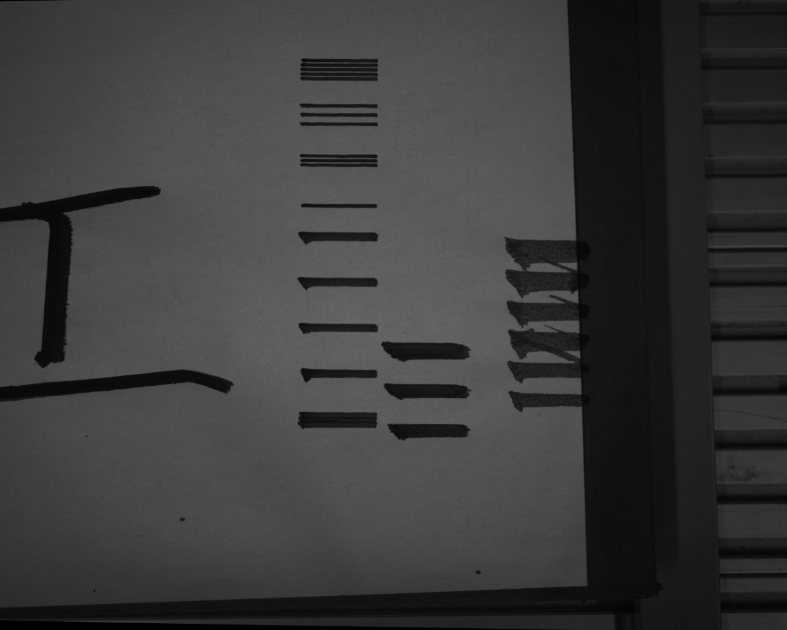
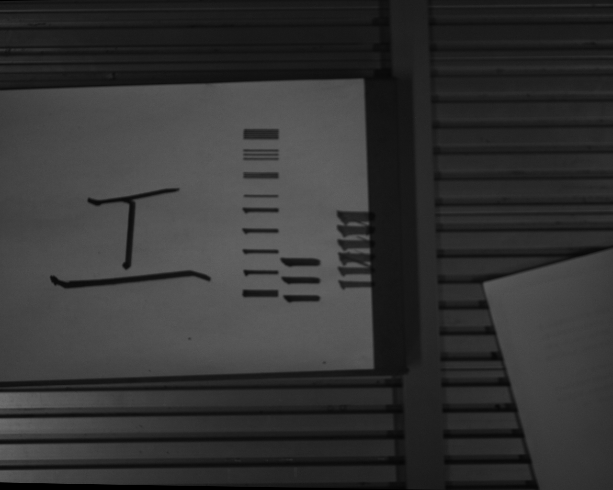

# UR10“工”字试写进展（2026-10-29 同步）

本目录公开本次进展摘要、冻结的三笔控制点及纸面测量记录。它不是可下发运动包；完整候选、实际程序、原始反馈/力、深度点云和 V16 权重仍在 MU 的被忽略目录中。

## 已取得的结果

- 2026-10-28 10:08、10:40（北京时间）：原始 0.045 H 增益完成两次完整三笔试写。
- 19:31：0.22 H 增益完成完整三笔程序；随后一次重试因起点参考误差达到10 N而在发布前拒绝，保留失败。
- 21:13:42：`0.22 × H_model + 1.6 mm` 纸面补偿版完成427个实际路点、三笔0/1/2及最后抬笔。候选424点，原16个控制点（6＋4＋6）逐行保留。保存的guard ticks中力增量峰值8.442 N；用户接受的运动停止默认值100 N与参考误差接受限值10 N分别记录。
- 纸面点云估计当前纸面比历史平面低1.61 mm，倾角0.54°，残差p50 0.32 mm、p95 1.01 mm。1.6 mm为本次指令补偿，不等于独立测得毛束压入。
- 图像和点云已采集。实施方报告补偿后平均线宽5.21 mm、竖笔7.60 mm；发布时未独立复算。使用过有既有墨迹的纸面，最新图像也裁掉部分字符，不能用此图证明空白纸上单遍质量或重复性。

[进展摘录](progress.json)绑定本地来源及原文件摘要；[实施方验收材料](../../docs/验收_20261028_工字完整三笔.md)保留历史阶段、失败及未完成项；[全部运行命令](../../docs/机械臂写字.md)记录现场条件。

## 轨迹文件

- `scaled_initial_pose.numeric.csv`：冻结完整源轨迹，16控制点。源x/y不是毫米或机器人Base坐标；z是模型H(mm)，不是实际Z/压力/压入量；角度rad。
- `organized_controls.csv`：既有纸面转换后的相同16点；`paper_x_m/paper_y_m`为纸面米坐标，尚未加入试写平移；源画布绝对gamma、切向相对gamma、纸面绝对gamma分别保留，转换一次。
- `paper_plane_record.json`：此次现场平面记录的原件副本；保留它自己的估计范围，不作为通用标定默认。

权重仍冻结为 `outputs/paper_bbsmg_general_v16_pose_dense/bbsmg_best.pt`，未随仓库上传。B-BSMG是姿态到局部足迹的正向模型；本次采用现成选定轨迹，没有重新训练/反演。

## 当前图像

纸面补偿版实拍（部分字符超出视野，保留原图）：

较早版本的整纸广角画面（不同阶段，不能当作补偿版全幅结果）：

## 验证和剩余工作

发布检查只执行MU本地软件测试与读取，没有连接jx或发送运动。最终软件测试结果见本次提交说明及机械臂命令文档。默认100 N与停稳/起终点容差放宽均已得到用户明确允许。

完整H/姿态映射、3点力参考的完整姿态覆盖、线宽/纸面重复性、边缘毛刺和提笔拖痕的最终质量验收尚未完成。本体约17.44mm为本次现场接受的间隙，未标成20mm通过。
