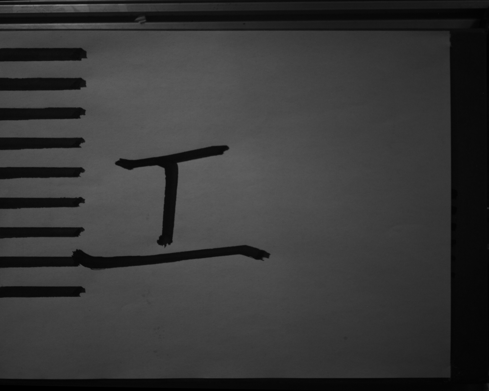

# 10月30日试写与方案进展（2026-11-02同步）

本目录是本机记录的公开摘录，不是运动包。它接续[10月28日进展](../gong_trial_20261028/README.md)，不覆盖此前的成功和失败记录。同步仅在MU完成，没有访问jx或驱动机械臂。

## 新的完整程序完成记录

| 候选 | 完成时间（北京时间，2026-10-30） | 实际路点 | 换算/范围 |
| --- | --- | --- | --- |
| `gong_current_mount_trial_cal28` | 13:32:40 | 427 | H增益0.28，指令下压4.68～7.20mm，姿态增益0.2/0.2/0.02 |
| `gong_current_mount_trial_g025` | 16:47:07 | 427 | H增益0.22，纸面高度−2.98mm，姿态增益0.25/0.25/0.02 |

两者原始RESULT均为 `completed_buffered_program`、`motion_sent=true`；各自程序包含三笔0/1/2并以抬笔结束。这里只确认程序完成，不把它改写为笔迹质量或重复性验收通过。

[查看逐次结果与候选状态](progress.json)：11份运行记录，其中2次完整程序完成、9次错误停止（含发布前拒绝和已运动后的停止），另列22份准备候选。记录实际状态、错误、源文件摘要、深度/姿态换算、数值失败及子路线范围。

## 完整姿态与分笔实验仍未完成

- `full6e` 的离线数值检查通过，但实机程序超时停止。
- `z7` 直接使用模型H并做[0.5,20]mm裁剪、三姿态增益均为1；存在数值审计失败及显式接受标记，实机仍超时停止。该尝试与最初“不裁剪H”的冻结转换约定不同，不能称原模型方案等价复现或最终默认。
- 后续 `z7_s2*` 为子路线尝试，陆续被原目标悬空高度、参考误差、力数据1.5s过期或关节速度估计条件停止。
- 最新`s2h`只有准备结果，数值审计83个失败，仍带父方案接受标记；没有完整成功的实机记录。接受标记不代表数值/圆滑邻域检查通过，也不代表本次发布重新核实了授权。

最新本机准备记录截至2026-10-30 21:43，本次未发现11月2日新的实机运行结果。完整三笔的最近成功仍是上表两个方案，不是后面的深压/完整姿态/分笔实验。

## 本轮代码与文档

- 下压梯支持每行alpha/beta、纸面高度、悬空高度及落笔速度；按纸面测量范围限制布局。
- 换算工具增加纸面表面高度、姿态增益、平滑、重新采样、悬空分段、裁剪及失败接受记录等实验选项；切片工具重建子路线审计。
- 起点接入支持姿态/位置接近时的直接接入；拍照位程序预算按段数计算。
- 当前代码将局部参考误差阈值及起点参考阈值也改为100N；这与历史10N接受记录是不同版本。文件名`unloaded_reference_acceptance_10N.json`不能代替读取其中的实际数值。下压梯CLI仍有自己的默认力阈值，运行记录优先于“一律100N”等概括表述。
- [整体方案与高质量笔画生成](../../docs/写字机器人整体方案与高质量笔画生成.md)新增系统、笔画反馈和重复实验流程图。自动质量反馈、可重复H/姿态响应及高质量端点控制仍为拟实施内容，不标为已实现。

这些是实验代码的同步，并非为新选项追加实机放行。历史通过的完整程序记录不自动验证后来修改过的换算、平滑、裁剪或接入策略。

## 原始照片

`g025`后采集的固定相机原图（同纸面还有标定线；没有在发布时重新测量线宽或清除旧墨）：

完整力/位姿流、原始程序、点云和权重仍在本机`outputs/`，不随本次公开摘录上传。上图不替代重复性或最终质量验收。
