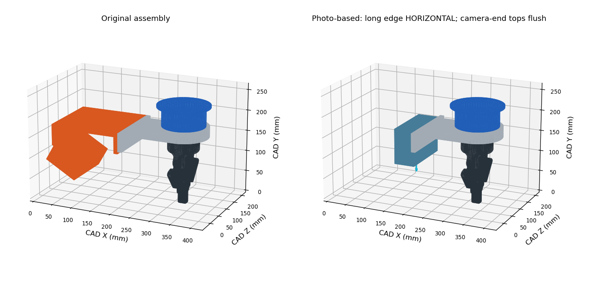

# Mech-Eye PRO XS 相机直装模型（2026-10-27）

最终安装关系：**移除橙色中间支架，长边水平，130 × 85 mm 宽侧面贴灰色支架侧面，顶部与相机端支架上表面齐平**。原 CAD 外形为 130 × 85 × 50 mm，安装后 CAD X/Y/Z 为 50 × 85 × 130 mm。顶部 CAD Y=175.73761 mm，不使用传感器座高出的 13 mm 台阶。



## 来源和装配

`source_cad/` 保留原相机/支架布尔合并体及灰色连接件，用于离线恢复相机八个角点并补齐接触面。原始 CAD 来源及相同模型已发布到共同维护的 [UR10 仓库提交 5cdf834](https://github.com/jinxiao123580-hub/UR10/commit/5cdf834f69a339f8ff3afde67da9acff3de36326)。不包含用户实物照片。

详细参数见 [assembly.json](assembly.json)。外壳中心在 tool0 下约 `[0, 0.155, 0.1055]` m，采用原 CAD 注册旋转。相机随末端刚性转动；光学方向只作名义示意，外壳变换不是手眼标定。

## ROS 仿真模型

仓库 `ros2_sim_ws/src/fusion_model_ros2_beta` 与 MU 实际 CAD 装配同步：四个末端 STL、URDF、对应碰撞包络、资源安装规则和来源记录。力传感器、灰色连接件与闭合夹爪沿用 MU 原网格及装配；毛笔相对 tool0 的位置保持 220 mm，工厂运动学保持原值。URDF 硬件接口为 `mock_components/GenericSystem`。

旧光学帧保留为 `mecheye_camera_optical_frame_legacy_20260921`，不代表新安装；手眼配置未重新标定。新增 `config/camera_mount_model_20261027.yaml` 记录模型状态。本机源目录与 `install_actual_ur10` 既有安装链接已同步。后续发布由 MU 完成，不连接 jx。

## 离线重新生成

在仓库根目录运行，以下仅生成模型文件和预览，不访问设备：

```bash
python3 integration/ur10_camera_direct_mount_20261027/camera_direct_mount.py --source-dir integration/ur10_camera_direct_mount_20261027/source_cad --output outputs/camera_direct_mount_20261027/camera_direct_mount.stl --report outputs/camera_direct_mount_20261027/assembly.json
python3 integration/ur10_camera_direct_mount_20261027/render_comparison.py
```

默认预览写入 `outputs/camera_direct_mount_20261027/assembly_comparison.png`。模型使用源 CAD 简化外形，不表示安装孔、光学原点或新手眼标定已验证。已检查尺寸、闭合网格、宽面贴合、顶部齐平、URDF、网格/碰撞包络一致性；模型及仿真启动约束软件检查 7 项通过；没有操作实机或进行新标定。
